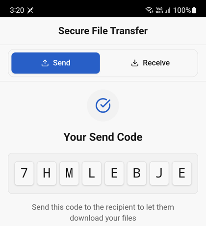
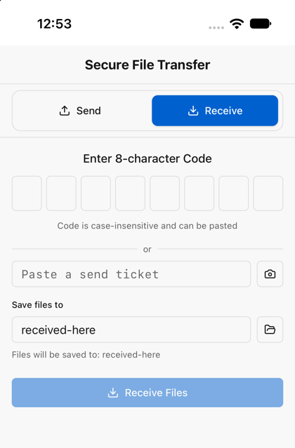
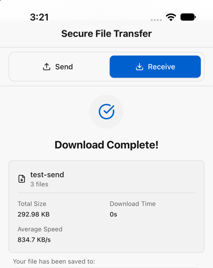

# SendMe

Send files and folders directly between your devices, with no cloud in between.
Built with Tauri v2, React and [Iroh](https://iroh.computer/). Runs on macOS,
Windows, Linux, Android and iOS.

<p>
  
  
  
</p>

## How it works

1. **Pick** files or folders on the sending device and tap *Generate Send Code*.
2. **Share** the result: a short code, or a ticket as text and a QR code.
3. **Receive** on the other device by entering the code, or pasting or scanning
   the ticket, and choose where to save.

Files travel straight from device to device, encrypted. If a file already
exists on the receiving side, you choose to overwrite or keep both.

Short codes need a small lookup server, and the app only offers them when one
is reachable. Tickets and QR codes always work, with no server at all. A free
server you can deploy yourself is in [server/](server/README.md).

## Run it

```bash
scripts/doctor.sh     # checks your setup and says what to install
yarn install
yarn tauri dev        # desktop
```

| Platform | Needs | Run | Build |
|----------|-------|-----|-------|
| Desktop | Node 18+, Yarn, Rust | `yarn tauri dev` | `yarn build` |
| Android | Android Studio (SDK + NDK), `ANDROID_HOME`, `NDK_HOME` | `yarn android:dev` | `yarn android:build` |
| iOS (macOS) | Xcode, `xcodegen`, an Apple Team ID | `APPLE_DEVELOPMENT_TEAM=<your id> yarn ios:dev` | `APPLE_DEVELOPMENT_TEAM=<your id> yarn ios:build` |

Optional settings go in `.env` (copy [.env.example](.env.example)). Phones have
no `.env`, so set `BASE_URL` when building for them:
`BASE_URL=https://your-server yarn android:build`.

If the Rust build fails in the `ring` crate, a global `CC` such as `zig cc` is the
usual cause: run with `CC=cc CXX=c++`.

## Contributing

Run `scripts/ci-local.sh` before opening a PR. It runs the same checks as CI.
See [CONTRIBUTING.md](CONTRIBUTING.md).

```
src/          React frontend
src-tauri/    Rust backend (and the Android and iOS projects under gen/)
server/       Optional short-code server (Cloudflare Worker)
scripts/      doctor.sh, ci-local.sh, packaging and version scripts
docs/         Server API, pending checks
```

More: [Server API](docs/SERVER_API.md) · [Pending checks](docs/PENDING_CHECKS.md) ·
[Versioning](VERSIONING.md) · [Releasing](.github/RELEASE.md) ·
[Changelog](CHANGELOG.md) · [Security](SECURITY.md)

## License

MIT. See [LICENSE](LICENSE).
